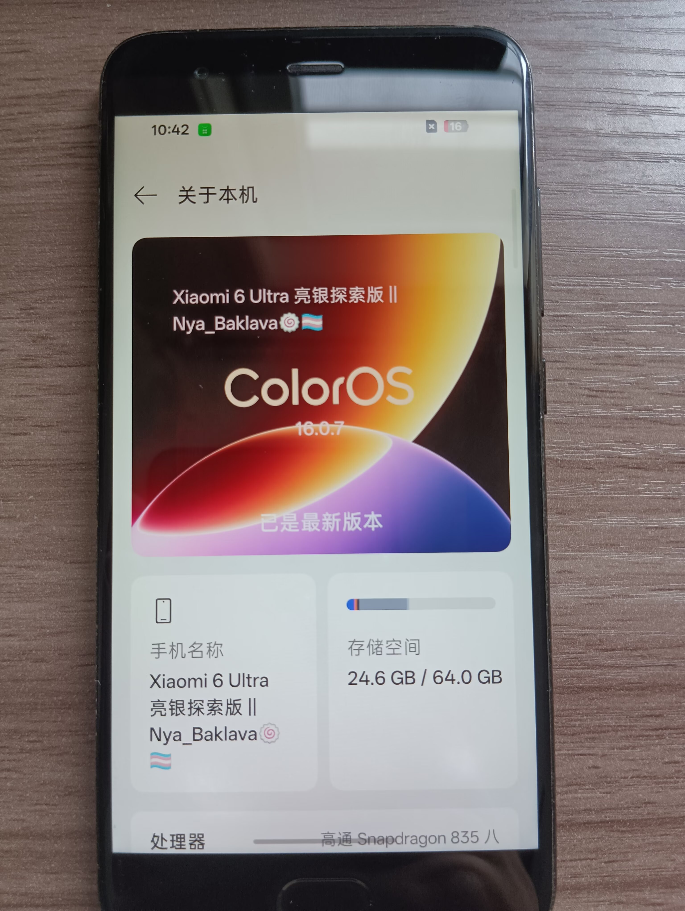
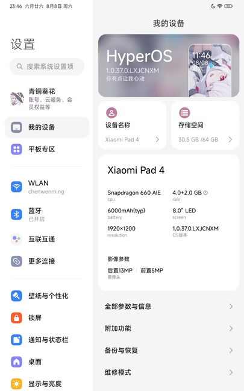

## 起因：root ——安卓最高权限
早在初一我就因为手机桌面美化认识到了root，深感好奇，当时也深入了解过想要获取，奈何没有pc，技术有限对计算机认识也比较笼统最后也就不了了之。但最近，一次突发奇想，翻出了老爸的小米6——一代机皇（奈刷王），在毕站、酷安、ai高强度冲浪查找资料后我终于有足够的底气去圆这个“一时兴起”
- 搞机第一步：解锁（bootloader）
米6解锁对新手极其友好，开发者模式→设备解锁→绑定账号→按引导下载pc端工具并完成解锁，注意如若解锁工具识别不到手机，一定一定要安装usb3.0驱动（好像是这个名来着）搞机助手里就可以一键安装
- 搞机第二步：刷入第三方recovery
在我重做电脑系统后（做电脑系统我也写了一篇）我对计算机的系统有了更深的理解，recovery简单来说就是一个隐藏的系统，它可以在计算机的主系统（即安卓上的hyperOS、originOS、colorOS...）损坏或想要更换系统时帮你更简易的自救更换，其实每个厂商的手机都自带一个rec（recovery简称下文同）但它太简易了，所以要实现刷机、刷root、刷内核等等一系列搞机玩法，一个好用的第三方rec就显得尤为重要。常见的rec想必大家一搜就能搜到，无非就是TWRP、橙狐之类的，刷写过程简单说下：下载你手机对应版本的rec镜像→pc安装fastboot驱动→手机（解锁后）进入fastboot模式（fastboot模式每个厂商的机子进入方法不一）→打开pc端cmd输入
```cmd
fastboot flash boot "你的rec镜像文件地址"
```
- 搞机第？？步哈哈其实做完上面的步骤你就已经完成所有搞机前置任务了，接下来就是看你要怎么搞了

## 刷入友商的ROM
有搞头？我把米6的miui换成了colorOS16！！

把米pad4的miui换成了hyperOS1！！

这些都是在酷安找的刷机包，刷入方法是：
1、在pc数据线连fastboot模式下的手机运行大佬编的脚本刷入。
2、也可以把ROM包放到手机存储目录，在rec模式下直接安装 刷机包.zip，但要注意刷友商、第三方ROM或跨大版本更新原系统可能需要执行双清更甚者需要格式化data分区，但格式data你本地存储的卡刷包又没了，这就需要在你手机插入存储TF卡存卡刷包或打开rec的MTP模式接电脑传入你的卡刷包来刷机了

## 刷入root权限
这是最简单的一个折腾选项，刚认识root原以为这个权限这么大获取肯定很难，但实操后知道了解锁才是最难。。
简易过程以magisk面具为例（其他的没用过，kernelsu需要内核版本在5.x以上来着我的机子无一例外没这么高，我也懒得研究刷内核了）：在你的机子安装magisk应用→进应用会显示无法获取直接点最上面的安装→选择镜像文件把你装的ROM里的boot.img放进去修补→修好的镜像传pc手机进fastboot并连接pc,cmd执行命令
```cmd
fastboot flash boot "magisk修补好的boot镜像地址"
```
或者懒得用电脑，直接进rec点安装，安装镜像，选择并安装，完事

## 主力机（hyper 1）解锁
前面的机器都是老古董miui，官方提供解锁渠道，但小米的机子一旦升级了澎湃系统，呵呵，有多难你可以去搜搜看。本以为我主力机子无缘搞机（其实无论高通还是联发科的芯片都有深度刷机模式可以强解bl锁但都需要拆机，物理改一些东西我没信心能折腾出来所以不在考虑范围内），但在无数次翻阅查找方法时我找到了[这个视频](https://www.bilibili.com/video/BV1hJADzpEeG)，一切迎刃而解，帖子最后我只想说，小孩哥nb！


