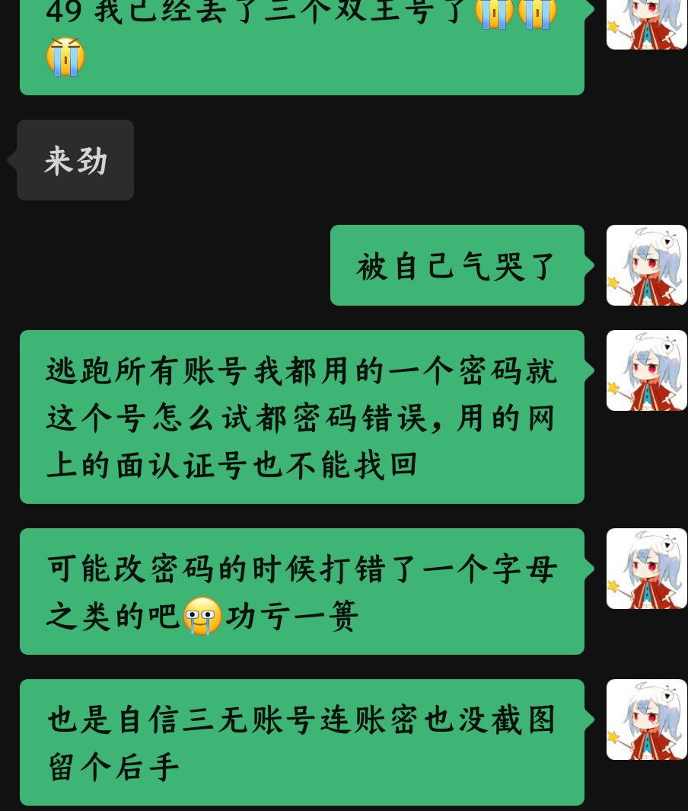
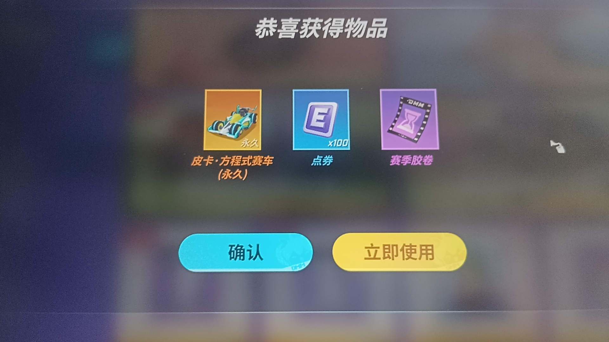

### 2026年7月3日
妈的今天更新逃少49的号又丢了RT

我去了第一个大号不能说玩的很多吧但已经注册了400天了，小号开挂被白日梦误封了，第二个号同上，然后再注册号就不能过实名了（49一个身份证号只能认证有限数量个账号）我就从朋友那找了个免实名的号（三无，一没改邮箱，二不知道能绑手机号，三没有多余的第三方社交账号给他绑，也就是说没有任何找回的后手。这个号也就是第三个也打了少说三四个月吧沟槽的更新之后密码输不对了，我设置密码一向很有规律不可能记错的，妈的可能输错了个字母怎么也进不去了😭😭😭，再也没有精力去起一个新号了。我真要求不高的想49，q厅都有一个双王的号方便联机。。。我的无力成为了我的败笔。。。但q厅还好，给我出了个金算是给我一点慰藉吧

我不能再失去你了阿Q！！！追已经50星了！49等未来的朋友要玩再重起号吧

### 2026年7月11日
我脾气还是一如既往，看上了就想得到无论现不现实，我学习大概也是如此才能保持中上游的水平。。最近两天发现打游戏必须要听歌打了，因为难，我得不到胜利，难受只能通过骂人听歌发泄了，炫耀一下打了一年多把空洞的四门打过了！由此也引申出一些别的感悟吧：焦虑抑郁可能真的会陪伴我更久，他可能有90%都对我身心有坏处，但那10%的，对人生更深层次的认识、抑郁时对事物更平静客观的判断我一定会好好利用。我好像懂我自己了：一切都是为了得到，得到那些眼前的，哪怕无关紧要哪怕毁掉余生的东西。
报名职高了，之前母亲还一直问你想好了吗不行还能上私立高中。。就算我还有学习高中知识的欲望可我还怎么能相信我自己呢，一想到那么大的压力，我就隐约能感受到抑郁带来的寒冷与绝望，现在最大的愿望就是在职高能不惹到那种情绪，它太令人。。